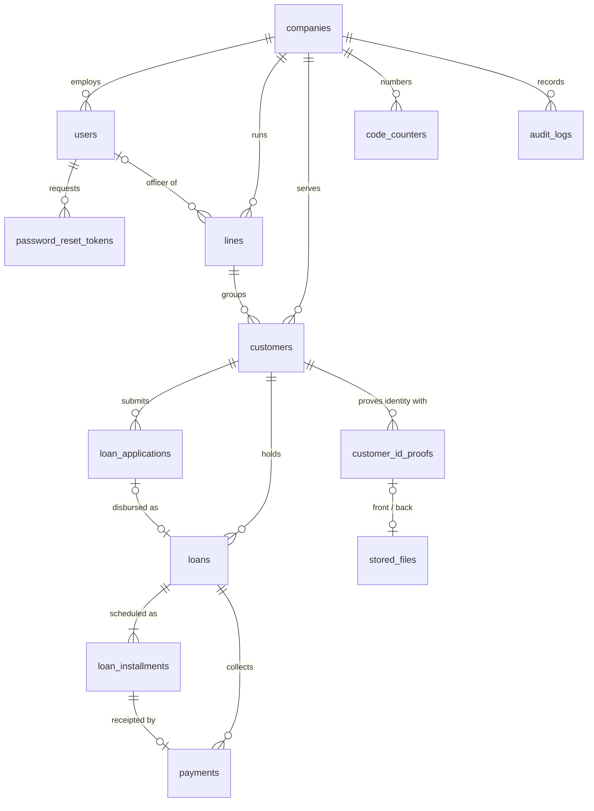

# Database schema

PostgreSQL 14+ (the compose file runs 16). The schema the running system uses is owned by the
Spring Boot API and defined in one Flyway migration:

`apps/api-spring/src/main/resources/db/migration/V1__schema.sql`

Flyway applies it on first start; Hibernate runs with `ddl-auto: validate`, so the API refuses to
boot if the tables and the entities in `com.microfin.lms.domain` disagree.

> There is a second, unrelated schema in `packages/db/prisma/schema.prisma`. It is not what the
> API uses. See [The Prisma schema](#the-prisma-schema-packagesdb) before touching it.

## Conventions

| Topic | Rule |
|---|---|
| Money | `BIGINT` whole rupees. No paise, no floats, anywhere. |
| Rates | `NUMERIC(6,3)` annual percent (`24.000` = 24% a year, flat). |
| Tenancy | Every business row carries `company_id`. Each query filters on the caller's company; nothing is shared between companies. |
| Public ids | Rows are addressed in the API by a human code that is unique per company (`L04`, `C-0007`, `APP-3104`, `LN-20418`). The `BIGINT` identity ids stay on the server, except user ids and the raw ids shown in the audit log. |
| Timestamps | `TIMESTAMP WITH TIME ZONE`, written in UTC. |
| Business dates | `DATE` (due, paid, disbursed). "Today" is decided in `LMS_ZONE` (`Asia/Kolkata`), not UTC. |
| Enums | `VARCHAR` with a `CHECK` constraint, upper-case in the database. Some travel lower-case in JSON (see [API manual](API_MANUAL.md#conventions)). |
| Derived figures | Outstanding, overdue, days late and loan state are computed from `loan_installments` on every read. They are not stored. |
| Deletes | Nothing is soft- or hard-deleted through the API except a customer's removed identity proof and its replaced or removed KYC photos. |

## Entity relationships



## Tables

### `companies`

One row per registered lender. Created by sign-up.

| Column | Type | Null | Notes |
|---|---|---|---|
| `id` | bigint identity | no | PK |
| `name` | varchar(120) | no | |
| `office_lat`, `office_lng` | numeric(9,6) | yes | Where collection routes start and end |
| `daily_target` | bigint | no | Rupees; default 0 |
| `created_at` | timestamptz | no | |

### `users`

Staff accounts.

| Column | Type | Null | Notes |
|---|---|---|---|
| `id` | bigint identity | no | PK. Exposed in the API as the user id |
| `company_id` | bigint | no | FK → `companies` |
| `full_name` | varchar(120) | no | |
| `email` | varchar(254) | no | Lower-cased login. **Globally unique** (`uq_users_email`), not per company |
| `phone` | varchar(15) | no | |
| `password_hash` | varchar(100) | no | bcrypt |
| `role` | varchar(20) | no | `ADMIN` \| `MANAGER` \| `LOAN_OFFICER` |
| `status` | varchar(12) | no | `ACTIVE` \| `SUSPENDED` |
| `token_version` | int | no | Bumped on every password change; JWTs carrying an older value are refused |
| `last_login_at` | timestamptz | yes | |
| `created_at` | timestamptz | no | |

Index: `idx_users_company (company_id, role)`.

### `password_reset_tokens`

| Column | Type | Null | Notes |
|---|---|---|---|
| `id` | bigint identity | no | PK |
| `user_id` | bigint | no | FK → `users`, `ON DELETE CASCADE` |
| `token_hash` | varchar(64) | no | Unique. Only the hash is stored; the raw token goes to the user |
| `expires_at` | timestamptz | no | 30 minutes after issue (`lms.auth.reset-ttl`) |
| `used_at` | timestamptz | yes | Set when redeemed; a token works once |
| `created_at` | timestamptz | no | |

### `code_counters`

Last number handed out per company for each kind of code. Incremented under a row lock in its
own transaction (`CodeService`), so a number is skipped if the surrounding operation fails.

| Column | Type | Null | Notes |
|---|---|---|---|
| `company_id` | bigint | no | PK part, FK → `companies` |
| `name` | varchar(20) | no | PK part: `line` \| `customer` \| `application` \| `loan` |
| `last_value` | bigint | no | |

| Kind | Format | First value |
|---|---|---|
| line | `L%02d` | `L01` |
| customer | `C-%04d` | `C-0001` |
| application | `APP-<n>` | `APP-3101` |
| loan | `LN-<n>` | `LN-20001` |

Receipt numbers are not counted; they are derived as `RC-<loan digits>-<seq>` (`RC-20418-03`).

### `lines`

A collection round: one officer, one frequency.

| Column | Type | Null | Notes |
|---|---|---|---|
| `id` | bigint identity | no | PK |
| `company_id` | bigint | no | FK → `companies` |
| `code` | varchar(12) | no | Unique per company (`uq_lines_code`) |
| `name` | varchar(120) | no | Unique per company, case-insensitive — enforced in `LineService`, not by a constraint |
| `officer_id` | bigint | yes | FK → `users`. Null = unassigned |
| `frequency` | varchar(20) | no | `DAILY` \| `WEEKLY` \| `MONTHLY` \| `MONTHLY_INTEREST` |
| `schedule` | varchar(12) | yes | Weekday name for weekly, `1`-`28` or `Last day` for monthly, null for daily |
| `created_at` | timestamptz | no | |

`frequency` and `schedule` describe the round. They do not drive the installment schedule:
every loan is scheduled monthly from its disbursal date.

### `stored_files`

Metadata for uploaded KYC photos. The bytes live on disk under `LMS_STORAGE_DIR`.

| Column | Type | Null | Notes |
|---|---|---|---|
| `id` | uuid | no | PK, also the file name on disk |
| `company_id` | bigint | no | FK → `companies` |
| `original_name` | varchar(255) | no | |
| `content_type` | varchar(100) | no | Decided from the file's first bytes: JPEG, PNG or WebP |
| `size_bytes` | bigint | no | |
| `storage_path` | varchar(255) | no | Relative: `<company_id>/<uuid>.<ext>` |
| `uploaded_by` | bigint | yes | FK → `users` |
| `created_at` | timestamptz | no | |

### `customers`

| Column | Type | Null | Notes |
|---|---|---|---|
| `id` | bigint identity | no | PK |
| `company_id` | bigint | no | FK → `companies` |
| `code` | varchar(12) | no | Unique per company (`uq_customers_code`) |
| `line_id` | bigint | no | FK → `lines` |
| `name` | varchar(120) | no | |
| `phone` | varchar(10) | no | Unique per company (`uq_customers_phone`) |
| `alt_phone` | varchar(10) | yes | |
| `parent_name` | varchar(120) | no | Father / spouse / guardian |
| `address` | varchar(300) | no | |
| `requested_amount` | bigint | no | Rupees |
| `status` | varchar(10) | no | `PENDING` \| `APPROVED` \| `ACTIVE`. Moves to `APPROVED` when an application is approved and `ACTIVE` at disbursal; it never moves back |
| `geo_lat`, `geo_lng` | numeric(9,6) | yes | Doorstep pin |
| `geo_accuracy` | numeric(8,2) | yes | Metres |
| `geo_captured_at` | timestamptz | yes | |
| `created_by` | bigint | yes | FK → `users` |
| `created_at`, `updated_at` | timestamptz | no | |

Index: `idx_customers_line (line_id)`.

Identity proofs live in `customer_id_proofs` (migration `V2`; until then they were columns on
this table).

### `customer_id_proofs`

A customer's government IDs, at most one of each type. Any one of them counts as "proof on file"
for approval.

| Column | Type | Null | Notes |
|---|---|---|---|
| `id` | bigint identity | no | PK |
| `customer_id` | bigint | no | FK → `customers`, `on delete cascade` |
| `id_type` | varchar(20) | no | `AADHAAR` \| `PAN` \| `VOTER_ID` \| `DRIVING_LICENSE` \| `PASSPORT`. Unique per customer (`uq_customer_id_proofs_type`) |
| `id_number` | varchar(255) | no | **AES-GCM ciphertext** (`IdNumberCipher`, key `KYC_ENCRYPTION_KEY`) |
| `front_file_id`, `back_file_id` | uuid | yes | FK → `stored_files` |
| `created_by` | bigint | yes | FK → `users` |
| `created_at`, `updated_at` | timestamptz | no | |

Index: `idx_customer_id_proofs_customer (customer_id)`.

Because `id_number` is encrypted with a random nonce it cannot be searched or made unique in
SQL, and it becomes unreadable if `KYC_ENCRYPTION_KEY` changes.

### `loan_applications`

| Column | Type | Null | Notes |
|---|---|---|---|
| `id` | bigint identity | no | PK |
| `company_id` | bigint | no | FK → `companies` |
| `code` | varchar(16) | no | Unique per company (`uq_applications_code`) |
| `customer_id` | bigint | no | FK → `customers` |
| `line_id` | bigint | no | FK → `lines`. The customer's line when submitted |
| `type` | varchar(4) | no | `POST` \| `PRE` |
| `principal` | bigint | no | |
| `annual_rate_pct` | numeric(6,3) | no | |
| `months` | int | no | Tenure |
| `fee` | bigint | no | |
| `emi` | bigint | no | Agreed installment (may be rounded up from the calculated one) |
| `disburse_on` | date | no | Requested disbursal date |
| `submitted_on` | date | no | |
| `submitted_by_id` | bigint | yes | FK → `users`. Who actually submitted it |
| `submitted_by` | varchar(120) | no | The line officer's name at submission, kept as text so reassignment does not rewrite history |
| `status` | varchar(10) | no | `PENDING` \| `APPROVED` \| `REJECTED` \| `DISBURSED` |
| `note` | varchar(500) | yes | Approval note or rejection reason |
| `decided_on` | date | yes | |
| `decided_by_id` | bigint | yes | FK → `users` |
| `loan_id` | bigint | yes | FK → `loans`. Set at disbursal |
| `created_at` | timestamptz | no | |

Indexes: `idx_applications_status (company_id, status)`, `idx_applications_customer (customer_id)`.

"One open (`PENDING` or `APPROVED`) application per customer" is enforced in
`ApplicationService`, not by a constraint.

### `loans`

Written once at disbursal. Terms are copied from the application and never change.

| Column | Type | Null | Notes |
|---|---|---|---|
| `id` | bigint identity | no | PK |
| `company_id` | bigint | no | FK → `companies` |
| `loan_no` | varchar(16) | no | Unique per company (`uq_loans_no`) |
| `customer_id` | bigint | no | FK → `customers` |
| `line_id` | bigint | no | FK → `lines` |
| `type` | varchar(4) | no | `POST` \| `PRE` |
| `principal` | bigint | no | |
| `annual_rate_pct` | numeric(6,3) | no | |
| `months` | int | no | |
| `fee` | bigint | no | |
| `emi` | bigint | no | |
| `total_interest` | bigint | no | `principal × rate × months / 1200`, rounded half-up |
| `total_payable` | bigint | no | What the schedule recovers: `principal + interest` (POST) or `principal` (PRE) |
| `net_disbursal` | bigint | no | Cash handed over: `principal − fee` (POST) or `principal − interest − fee` (PRE) |
| `disbursed_on` | date | no | |
| `disbursed_by` | bigint | yes | FK → `users` |
| `status` | varchar(8) | no | `ACTIVE` \| `CLOSED`. "Overdue" is derived, not stored |
| `closed_on` | date | yes | Date of the last receipt |
| `created_at` | timestamptz | no | |

Indexes: `idx_loans_customer (customer_id)`, `idx_loans_line_status (line_id, status)`.

### `loan_installments`

One row per installment, written at disbursal. Monthly from `disbursed_on`; every row is the EMI
except the last, which takes the remainder so the schedule sums to exactly `total_payable`.

| Column | Type | Null | Notes |
|---|---|---|---|
| `id` | bigint identity | no | PK |
| `loan_id` | bigint | no | FK → `loans`, `ON DELETE CASCADE` |
| `seq` | int | no | 1-based. Unique per loan (`uq_installments_seq`) |
| `due_on` | date | no | |
| `amount` | bigint | no | |
| `balance_after` | bigint | no | Outstanding once this one is paid |
| `paid_on` | date | yes | Null = unpaid |

Index: `idx_installments_due (due_on, paid_on)`.

### `payments`

One receipt per installment, paid in full. There are no part payments, penalties or reversals.

| Column | Type | Null | Notes |
|---|---|---|---|
| `id` | bigint identity | no | PK |
| `company_id` | bigint | no | FK → `companies` |
| `loan_id` | bigint | no | FK → `loans` |
| `installment_id` | bigint | no | FK → `loan_installments`. Unique (`uq_payments_installment`) — an installment cannot be receipted twice |
| `seq` | int | no | Copy of the installment's `seq` |
| `receipt_no` | varchar(24) | no | Unique per company (`uq_payments_receipt`) |
| `amount` | bigint | no | |
| `paid_on` | date | no | Business date given by the collector |
| `days_late` | int | no | `paid_on − due_on` |
| `mode` | varchar(8) | no | `CASH` \| `UPI` |
| `posted_at` | timestamptz | no | When the server recorded it |
| `geo_lat`, `geo_lng` | numeric(9,6) | yes | Where the collector was |
| `geo_accuracy` | numeric(8,2) | yes | |
| `collected_by_id` | bigint | yes | FK → `users` |
| `client_op_id` | varchar(64) | yes | Idempotency key minted on the device. Unique per company (`uq_payments_client_op`) |

Indexes: `idx_payments_paid_on (company_id, paid_on)`, `idx_payments_loan (loan_id)`.

### `audit_logs`

Append-only trail.

| Column | Type | Null | Notes |
|---|---|---|---|
| `id` | bigint identity | no | PK |
| `company_id` | bigint | no | FK → `companies` |
| `actor_id` | bigint | yes | FK → `users` |
| `action` | varchar(40) | no | See below |
| `entity` | varchar(30) | no | `COMPANY` \| `USER` \| `LINE` \| `CUSTOMER` \| `APPLICATION` \| `LOAN` |
| `entity_code` | varchar(40) | yes | The row's code, or the numeric id for users and companies |
| `detail` | varchar(1000) | yes | Free text. Never contains an ID number |
| `created_at` | timestamptz | no | |

Index: `idx_audit_entity (company_id, entity, entity_code)`.

Actions written today: `SIGN_UP`, `SIGN_IN`, `PASSWORD_RESET_REQUESTED`, `PASSWORD_RESET`,
`PASSWORD_CHANGED`, `USER_CREATED`, `USER_UPDATED`, `COMPANY_UPDATED`, `LINE_CREATED`,
`LINE_UPDATED`, `CUSTOMER_CREATED`, `CUSTOMER_UPDATED`, `GEO_CAPTURED`, `GEO_CLEARED`,
`KYC_SAVED`, `APPLICATION_SUBMITTED`, `APPLICATION_APPROVED`, `APPLICATION_REJECTED`,
`LOAN_DISBURSED`, `PAYMENT_RECORDED`.

## Lifecycles

```
application:  PENDING ──approve──▶ APPROVED ──disburse──▶ DISBURSED
                 └────reject────▶ REJECTED

customer:     PENDING ──(application approved)──▶ APPROVED ──(loan disbursed)──▶ ACTIVE

loan:         ACTIVE ──(last installment receipted)──▶ CLOSED
installment:  paid_on null ──(receipt)──▶ paid_on set      (strictly in seq order)
```

## Concurrency

- **Receipts** take `SELECT … FOR UPDATE` on the loan row, so two collectors cannot both receipt
  the same installment. `uq_payments_installment` is the backstop.
- **Decisions and disbursal** lock the application row the same way.
- **Code minting** locks the `code_counters` row in a separate, short transaction.
- **Offline retries** are made safe by `uq_payments_client_op`.

## Changing the schema

1. Add `V2__<what>.sql` (then `V3__…`) next to `V1__schema.sql`. Never edit a migration that has
   been applied anywhere; Flyway checksums them.
2. Update the matching entity in `apps/api-spring/src/main/java/com/microfin/lms/domain`.
3. Run `./mvnw test`. The tests run the migrations against H2 in PostgreSQL mode and Hibernate
   validates the result, so stick to SQL both engines accept or the suite will not start.

Useful queries:

```sql
-- applied migrations
select version, description, installed_on, success from flyway_schema_history order by installed_rank;

-- outstanding per loan, the way the API derives it
select l.loan_no, l.total_payable - coalesce(sum(i.amount) filter (where i.paid_on is not null), 0) as outstanding
from loans l join loan_installments i on i.loan_id = l.id
group by l.id order by l.loan_no;
```

## The Prisma schema (`packages/db`)

`packages/db/prisma/schema.prisma` is an earlier, more ambitious design written for the Node API
that was never built out: branches, devices, OTP challenges, guarantors, configurable loan
products, a transaction ledger with payment allocation, penalties and a sync-operation log. Money
there is integer **minor units (paise)**, the opposite of the live schema.

What to know:

- Nothing running reads it. `apps/api` (the Node stub) does not import `@lms/db`.
- It has no migrations directory, and the `db:seed` script points at `src/seed.ts`, which does
  not exist.
- **It maps to the same table names** (`users`, `customers`, `loans`, `audit_logs`, …) in the same
  `lms` database. Running `npm run db:migrate` against the database the Spring API uses will
  collide with the Flyway tables. Use one or the other, never both on one database.
- It is a useful reference for the features listed under "Not done yet" in
  `apps/api-spring/README.md` (part payments, penalties, products, OTP login).
